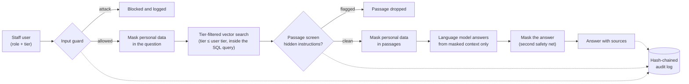

# Bank RAG Guard

**An AI assistant for bank staff that cannot leak what the asker is not cleared to see, and that proves it.**

   

| | |
|---|---|
| **Live demo** | `TODO: paste the public demo URL here` |
| **Demo video** | `TODO: paste the video link here` |
| **Team** | `TODO: list team members` |

---

## The problem

Banks want AI assistants that answer staff questions from internal documents: contracts, customer notes, emails. But a standard "retrieval-augmented generation" (RAG) assistant has three ways to leak:

1. **It retrieves documents the asker should never see**, then relies on the language model to behave.
2. **Personal data (names, IBANs, Emirates IDs, phone numbers) travels to the model** and back to the screen.
3. **Nobody can prove afterwards what was asked, what was shown, or that the log was not edited.**

Bank RAG Guard fixes the first by construction, reduces the second with bilingual (English/Arabic) masking, and answers the third with a tamper-evident audit trail.

## What it does

| Pillar | How it works |
|---|---|
| **Access control before the model** | Every document chunk has a sensitivity tier. The tier rule (`WHERE tier <= user_tier`) is part of the database query, so restricted text is never retrieved for the wrong user. The model cannot reveal what it never receives. |
| **Bilingual PII masking** | Rule-based masking (patterns plus checksums for IBANs and Emirates IDs, and a name masker for English and Arabic) is applied to the question, to every retrieved passage before the model sees it, and to the answer. |
| **Layered defences against attacks** | An input guard screens questions for injection and privilege-escalation attempts. A **passage screen** drops retrieved documents that contain hidden instructions aimed at the AI (indirect prompt injection). |
| **Tamper-evident audit log** | Every question, block and answer is written to an append-only, SHA-256 hash-chained log. Any edit to a past entry breaks the chain and is detected. |
| **Red-team harness** | An attacker model writes attacks, a judge (exact checks plus a language-model judge) scores them, and the guard can learn from attacks that get through. |

## How it works



1. The user signs in with a role. Each role has a tier (1 = lowest access, 3 = highest in the demo).
2. The **input guard** screens the question. Blocked questions never reach search and are logged.
3. The question is **masked**, embedded (multilingual, 768 numbers), and searched against the chunk table with the tier rule inside the SQL.
4. Each retrieved passage goes through the **passage screen**, then **masking**.
5. The language model answers using only the masked passages, and is told to say so when the information is not available at the user's level.
6. The answer is masked again, returned with its sources, and logged with chunk ids, tiers and masking counts (never raw text).

## Results

All numbers below were measured in this repository's notebooks. The samples are small; read them as evidence, not as proof.

| Test | Result |
|---|---|
| Tier enforcement: 2 questions asked as a tier-1 teller and a tier-3 compliance officer | Highest retrieved tier never exceeded the user's tier in any run. A teller asking about contracts (tier 2) got **0 sources** and an "not available at your access level" answer. |
| Personal data left in final answers (detectable by our masker) | **0** in all 4 runs of the tier test |
| 20 direct attacks (instruction override, system-prompt leak, personal-data extraction, privilege escalation) | **0 got through**, both with the guard off and with it on |
| Hidden instructions planted in a retrieved passage (5 trials) | **1 of 5** steered the answer with no passage screen; **0 of 5** with it |
| Passage screen on the 5 planted instructions | Flagged **5 of 5** |
| Passage screen on real passages | **0 of 40** wrongly flagged |
| Input guard on normal staff questions | **0 of 8** blocked (checked in each of 3 rounds) |
| Name masking, English, fresh unseen slice of a public benchmark | **67.0% recall**, **80.2% precision** (names are the hardest category) |
| Audit log | Chain verified over **244 entries**. `UPDATE`, `DELETE` and `TRUNCATE` are blocked by database triggers; the tamper demo (triggers disabled, one entry edited) is detected. |

**What we learned from the red-team loop.** The guard blocked every direct attack in all three rounds, so there was nothing for the "self-healing" step to learn from. The mechanism is implemented and tested (successful attacks are added to the guard's examples, and the next round uses brand-new attacks), but with today's attack set it has had no failures to heal from. The real weakness we found was **indirect injection through documents**, which is why the passage screen exists. Harder, multi-step attack sets are on the roadmap.

## Why IBM Z / LinuxONE

- **Runs where the data lives.** Core banking data is already on IBM Z and LinuxONE. An assistant that sits next to it avoids copying sensitive records into outside systems.
- **Built and demoed on the LinuxONE Community Cloud** (s390x, Ubuntu): PostgreSQL 16 with pgvector, FastAPI and the whole pipeline run on the s390x platform without code changes.
- **Security properties line up with the design.** The tier filter and audit log live in the database layer, so they inherit its access controls, encryption and backup policies.
- **Production path.** In this demo, masked text is sent to two external services (see limitations). In production, open-weight embedding and language models would be hosted on the same LinuxONE system so that no text leaves the bank.

## Theme alignment and community value

**Theme 2: Privacy, Identity and Secure AI.** The project addresses privacy (masking, access control before the model), identity (role and tier decide what each person can retrieve), and secure AI (prompt-injection defences, tamper-evident logs, red-team measurement).

**Community value.** Banks in the UAE and elsewhere handle Arabic and English customer data. Masking that works in both languages, and a way to *prove* an AI assistant respected access rules, helps compliance teams adopt AI without relaxing controls.

## Tech stack

| Layer | Choice |
|---|---|
| Platform | IBM LinuxONE Community Cloud (s390x, Ubuntu) |
| Database | PostgreSQL 16 with pgvector (cosine search, 768 dimensions) |
| Embeddings | Jina `jina-embeddings-v3` (multilingual), via REST |
| Language model | `openai/gpt-oss-120b` on Groq (free tier) |
| Backend | Python 3.12, FastAPI, psycopg 3 |
| Masking | Regular expressions with checksum validation, plus a name masker with English and Arabic rules |
| Notebooks | JupyterLab, one notebook per build step |

## Data

All data is synthetic or public.

| Data | Use |
|---|---|
| Synthetic customers and complaint notes (generated with Faker) | Customer data with personal identifiers |
| CUAD contracts (public) | Contract documents (tier 2 in the demo) |
| Enron emails (public) | Email documents |
| `ai4privacy/pii-masking-200k` (public) | Benchmark for the PII masker |
| `deepset/prompt-injections` (public) | Seed examples for the attacker |

The demo index holds 1,284 chunks across three tiers (499 / 572 / 213). Please check each dataset's own licence before redistributing it.

## Try it

**Online:** open the live demo link above, choose a user, and click the example buttons:

1. *Contracts (teller)* returns "not available at your access level" and no sources.
2. *Contracts (compliance)* returns contract text.
3. *Prompt injection* is blocked by the input guard.
4. Watch the **Audit log** panel update and show `Chain intact`.

**Run it yourself:**

```bash
git clone <repo-url> && cd bank-rag-guard
python3 -m venv venv && source venv/bin/activate
pip install -r requirements.txt

# PostgreSQL 16 with the pgvector extension must be installed and a database created.
cp .env.example .env          # then fill in the three values (never commit .env)

# Run the notebooks in order: they create the tables, load the data,
# build the embeddings and write the modules in src/
#   01 to 04b  setup, data, embeddings and PII masking
#   05_audit_log.ipynb          tamper-evident log
#   06_rag_answer.ipynb         the answer pipeline
#   07_adversarial_loop.ipynb   red-team tests and passage screen

uvicorn app:app --host 127.0.0.1 --port 8000
# open http://localhost:8000
```

## Repository map

```
app.py                       Web app (FastAPI): sign in as a demo user, ask, see sources and the audit log
src/
  pii.py                     Rule-based masking of identifiers such as IBAN, Emirates ID and phone, with checksums
  person_names.py            Name masker for English and Arabic
  masker.py                  Combines both maskers: find_all, mask_all
  audit.py                   Hash-chained audit log: append_event, verify_chain
  rag.py                     Answer pipeline: tier-filtered search, masking, model, audit
  guard.py                   Input guard and passage screen
notebooks (repo root)        One notebook per step, with outputs
data/                        Datasets, benchmark slices, red-team results
```

## Responsible use and limitations

We would rather you hear these from us.

- **Masked text still leaves the system in this demo.** Masked questions and passages are sent to Groq (language model) and Jina (embeddings). The production plan is to host both models on LinuxONE.
- **Name masking is imperfect.** 67.0% recall means about a third of names in the benchmark slice were missed; Arabic names are weaker still. Structured identifiers (IBAN, Emirates ID, phone) use patterns and checksums, which are more reliable. The access-control layer does not depend on masking: restricted text is never retrieved.
- **Small, partly synthetic tests.** 20 direct attacks and 5 poisoned-passage trials are far too few for statistical claims. The attacker is a language model plus a few hand-written attacks, and the judge combines exact checks with a language-model judge. Results can change with a different model or attack set.
- **Tail truncation is not detected.** A hash chain proves edits and deletions in the middle of the log, but someone with database superuser rights could remove the newest entries. Periodically publishing the latest hash to an outside location (anchoring) would close this gap.
- **Demo sign-in has no password** because all data is synthetic. A real deployment needs the bank's single sign-on.
- **Free-tier services** limit speed and volume, so the demo caps questions per visitor and per day.
- **Development note.** The project was built with AI coding assistance (Claude). The team ran every experiment and checked every number reported here.

## Roadmap

- Host the embedding and language models on LinuxONE so no text leaves the system.
- Harder red-team sets (multi-turn, encoded and indirect attacks) so the self-healing loop has failures to learn from.
- A larger leakage test suite (pytest) and an independent, human-written Arabic test set.
- Anchor the audit-log head hash externally to detect tail truncation.
- Real single sign-on and per-document access lists.

## Team

`TODO: names, roles, university` (IEEE Student Branch, Symbiosis International University Dubai).

## Licence

Code: MIT (see `LICENSE`). Datasets keep their own licences.
